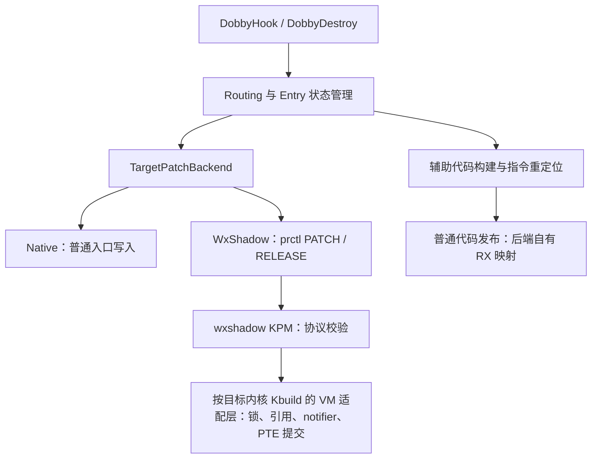

# Dobby 接入 wxshadow 设计方案

2026-10-19 更新：新增独立 portable 桥与 BTF 运行时适配，替代下文原版设计中的固定 5.10 VM 布局要求。实现变化及当前兼容边界见[跨内核兼容说明](kernel-compatibility.md)；以下日期及旧版边界为历史设计记录。

日期：2026-10-18。状态：P1 已实现，已通过 Android 12 / ARM64 / Linux 5.10.66 实机静态库和动态库测试。构建、接口、限制及测试记录见 [使用文档](dobby-wxshadow-usage.md) 和 [验证记录](dobby-wxshadow-validation.md)。P2 不属于本次支持范围。

分析基线：mkpms `29c4187`；本地 Dobby `5dfc8546954ce3b3198132ab13fddb89ee92cdd7`。

## 1. 目标与范围

增加可选的 WxShadow hook 后端。应用启用后，继续使用 `DobbyHook`、`DobbyDestroy`，由后端通过 `prctl` 调用 KPM，不要求另起 wxshadow_client。

首版范围：Android ARM64、4KB 页、当前进程、常规 ABI 的 native 函数入口。安装和卸载在应用启动单线程阶段，或调用方已协调停止目标页访问的阶段进行。安装完成后的多线程执行和读取须经过设备验证。原生 XOM 源映射、JIT/自修改代码、同页自读代码、BTI/PAC 特殊路径、任意指令位置的完整寄存器插桩，均不在首版支持范围。

普通后端保持默认行为。选择 WxShadowRequired 后，模块缺失、不兼容或资源不足都返回错误，不自动切回普通入口写入。后端固定记录在每个 Entry 中，卸载按该记录处理。

实现使用新增 PATCH_EX / RELEASE_EX 事务路径，不使用 BRK/SET_REG 模拟 Dobby 的用户态回调。隐藏范围是指定源代码页的修改内容；辅助代码及 Dobby 本身仍是普通进程映射。

## 2. 本地源码确认的接入点

| 位置 | 修改前的基线行为 | 已实现的接入方式 |
|---|---|---|
| `Dobby/source/InterceptRouting/InterceptRouting.h` 的 `Active()` | 调用 `DobbyCodePatch` 写入口 | 普通路径继续使用 Active；DobbyHook 在管理锁内分流到独立 WxHook |
| 同文件的 `GenerateTrampoline()` | 近跳板失败后回退普通跳板 | WxShadow 路径采用独立策略，失败直接返回 |
| `Dobby/source/MemoryAllocator/AssemblerCodeBuilder.h` | 也调用 `DobbyCodePatch` 发布生成代码，忽略返回值 | 生成代码保留普通写入；检查并传播错误 |
| `Dobby/source/TrampolineBridge/ClosureTrampolineBridge/arm64/ClosureTrampolineARM64.cc` | 闭包代码也经过 `DobbyCodePatch` | 同样保留普通映射和写入 |
| `Dobby/common/os_arch_features.h` | `make_memory_readable()` 在 Android 上执行页级 mprotect(RX) | WxShadow 路径不对受管目标页调用该助手 |
| `Dobby/source/MemoryAllocator/NearMemoryAllocator.h` | 会使用现有可执行映射里的零字节间隙 | WxShadow 的辅助代码只用后端拥有的独立映射 |
| `Dobby/source/Backend/UserMode/UnifiedInterface/platform-posix.cc` | 指定地址分配使用 MAP_FIXED | 新的近地址分配不得覆盖既有映射 |
| `Dobby/source/Interceptor.h` | 恢复原字节，丢弃写入结果，释放备份 | 按后端撤销；成功后再改变状态 |
| 同文件的 `inline static gInterceptor` | 头文件定义带内部链接的全局对象 | 接入多翻译单元后集中定义管理状态，避免后端看到另一份 Entry 表 |
| `Dobby/source/dobby.cpp` 的 `DobbyDestroy()` | 先删 Entry，再恢复入口 | 顺序反转；失败保留可重试状态 |
| `InlineHookRouting.h` / `InstrumentRouting.h` | BuildRouting 后直接 Active，最后才检查 error | 每步明确返回结果，失败停止后续发布 |
| `kpms/wxshadow/wxshadow_bp.c` | PATCH/RELEASE 按地址管理 | 原型可复用；稳定接入增加能力、归属和结果查询 |

不能将所有 `DobbyCodePatch` 调用统一替换成 PATCH。重定位代码的回跳、远跳板、闭包代码包含本页常量读取；若它们也变成只执行影子页，会遇到读取与取指异常反复切换的问题。

另一个容易遗漏的问题是：同页安装第二个 hook 时，即使入口写入已改为 PATCH，最前面的 `make_memory_readable()` 仍会改变整页权限。

## 3. 总体结构



内部由 `WxProbe / WxHook / WxRefresh / WxRemove / WxDiscard` 承担能力检查、校验与安装、状态刷新、精确撤销和未发布资源清理。它们返回明确结果，不使用析构函数隐式撤销可能仍在执行的入口。

`DobbyCodePatch` 保留普通补丁语义，不承担全局后端切换。其普通写入路径若命中已登记的受管页，应拒绝操作，避免破坏 shadow 状态。内部原生写入函数只写经验证属于 Dobby 的辅助映射。

主要新增文件：

- `Dobby/source/InterceptRouting/TargetPatchBackend.h`
- `Dobby/source/InterceptRouting/TargetPatchBackend.cc`：唯一管理锁、Entry 表、配置、辅助映射登记。
- `Dobby/source/Backend/UserMode/WxShadow/WxShadowBackend.cc`
- `Dobby/source/Backend/UserMode/WxShadow/WxShadowTrampoline.cc`
- `Dobby/source/Backend/UserMode/WxShadow/WxShadowCodeAllocator.cc`
- `shared/wxshadow_uapi.h`：独立于内核结构和 ktypes 的公共 ABI 定义。
- `kpms/wxshadow/wxshadow_protocol.c`：增强命令校验、实例、用户内存复制和分发。
- `kpms/wxshadow/linux/wxshadow_linux_adapter.c`：独立使用目标内核真实头文件编译的 VM 事务实现。

### 3.1 对外 API

接口已加入 `Dobby/include/dobby.h`：

```cpp
// 配置成功后，原有 hook API 的调用方式保持不变。
int rc = dobby_set_hook_backend(DOBBY_HOOK_BACKEND_WXSHADOW_REQUIRED);
if (rc != 0) {
    return rc;
}
return DobbyHook(target, replacement, &original);

// 撤销时仍调用 DobbyDestroy(target)。
```

配置只允许在没有活动或待恢复 Entry 时更改。首版 WxShadow 模式下，`DobbyInstrument` 明确返回不支持，避免在寄存器语义尚未验证时自动启用。

编译开关 `DOBBY_WITH_WXSHADOW` 默认 OFF，只对 Android ARM64 生效，同时应用到 `dobby` 和 `dobby_static`。`DOBBY_WXSHADOW_UAPI_DIR` 指向公共头目录。`DOBBY_WXSHADOW_TESTING` 仅供主机模拟测试，不得用于设备产物。用户态和 KPM 分开构建。

`dobby_get_hook_status` 刷新 cookie 状态；`dobby_get_hook_statistics` 返回最近已知的活动/恢复 Entry 数以及发布后保留的 WxShadow 辅助映射数量和字节数。选择 REQUIRED 后即使 Probe 失败，也保持严格模式，只有显式切回 NATIVE 才退出。

### 3.2 Entry 必须记录的信息

- backend、状态、创建该 Entry 的进程标识。
- 入口地址、实际 patch 地址、patch 长度和覆盖字节；首版为对齐的 4 字节。
- 原始字节、原函数重定位代码，以及重定位覆盖长度。patch 长度和重定位长度分别记录。
- relay 等辅助代码的分配句柄及所属页面。
- KPM 实例标识、映射代次、补丁 cookie；这些字段属于增强 ABI。
- 最近一次安装、回滚、释放结果，以及结果是否已确认。

以互斥锁串行化配置和管理操作，对每个受管页记录使用它的 Entry 集合。进程内管理锁不能代替执行线程协调或内核页表锁，也不能限制其他客户端修改同一页；增强 ABI 必须检查冲突。

Entry 索引、后端配置、互斥锁和受管页索引必须属于同一个进程内管理对象，在一个 `.cc` 中定义并通过声明访问。不要直接让新后端 `.cc` 引用当前头文件中的 `inline static gInterceptor`，否则可能操作不同的 Entry 表。辅助页归属也登记到这个统一管理对象中。

## 4. 入口跳板策略

首版入口固定使用单条 4 字节 B 指令。目的地址能直接到达时跳往 replacement，否则跳往后端自有的近地址 relay。

```text
目标入口（wxshadow 管理）
  └─ B → replacement
       或
     B → 近地址 relay（普通 RX）→ replacement

original 函数指针
  └─ 重定位代码（普通 RX）→ 原函数未覆盖部分
```

B 的距离校验使用有符号差值，范围为 `[-134217728, 134217724]` 字节，同时要求地址和距离均按 4 字节对齐。对齐入口的 4 字节补丁不会跨越 4KB 页边界，包括页末偏移 4092 的位置。

### 4.1 近地址 relay

1. 从 `/proc/self/maps` 的间隙选择仍在分支范围内的候选地址；首版每次创建独立页面，不复用代码池槽位。
2. 使用 MAP_FIXED_NOREPLACE；内核不支持该标志时尝试普通 hint mmap，始终核对实际返回地址和双向分支距离。
3. 新页先写入、刷新指令缓存，再设置为 RX；对已发布的代码槽不进行原地重用。
4. 不调用原分配器的代码间隙搜索，不在目标 ELF 或其他框架的页面中放 relay。
5. 不使用 MAP_FIXED 抢占扫描到的地址空洞。扫描 `/proc/self/maps` 后，布局仍可能变化。
6. 验证辅助页没有与任何受管源页重叠；反过来，新源页也不能覆盖现有辅助页或后端运行代码。
7. 无法分配则失败。WxShadowRequired 路径不回退到目标页内的 LDR literal 跳板。

relay 内的 LDR literal 可以保留，因为 relay 所在页面可读且不受 wxshadow 管理。原函数重定位代码中的 literal 和回跳也采用相同规则。

该策略独立于 `g_enable_near_trampoline`。当前 CMake 的 NearBranch 开关为 ON 不代表运行时已启用；运行时变量默认是 false。不能只修改构建开关就认为解决了跳板问题。

### 4.2 整页限制

4 字节入口解决的是 Dobby 新生成入口的自读问题，不能消除原函数剩余代码、同页其他函数的自读行为。因此首版验证对象应是页布局和行为已知的测试函数。replacement 或后端关键依赖若落入受管源页，也应拒绝。

不通过临时放宽源页权限来处理不支持的代码。BTI/PAC 路径需要单独设计入口保留、间接分支和返回语义，完成前明确返回不支持。

## 5. 与现有 KPM ABI 的连接

本节保留旧 ABI 原型分析。正式 Dobby 后端只使用第 6 节增强协议，不使用本节的 staging buffer 或按地址释放接口。

现有接口已经足以做受控原型：

```text
安装：prctl(PR_WXSHADOW_PATCH,   0UL, addr, buffer, 4UL)
撤销：prctl(PR_WXSHADOW_RELEASE, 0UL, addr, 0UL,    0UL)
```

参数按 unsigned long/uintptr_t 正确传递，目标进程固定为当前进程。为 PATCH 准备独立、页对齐且已写入的 4KB staging buffer，复制 4 字节入口到其中，确保缓冲区已有有效 PTE，且不跨页。不要直接依赖任意堆或栈缓冲区碰巧满足当前 KPM 的要求。

用户态应先读取、预触发目标页，再安装 PATCH。WxShadow 路径读取已经受管的源页时，通过模块的读取异常路径取得原始内容，不使用 `mprotect` 修改它。

撤销只使用实际安装地址。当前实现可精确移除该起始地址的记录，重建同页剩余修改，最后一个修改删除后执行页面 teardown。禁止用 addr=0 的全进程 release 替代单个 DobbyDestroy。

同起始偏移的 PATCH 当前会覆盖同一条记录，所以首版必须拒绝重复地址和重叠修改。不要据此实现多框架 hook 链。

### 5.1 现有 ABI 的不足

- GET_TLB_MODE 只能辅助判断命令是否存在，不能确认读/执行异常 hook 已成功安装。
- PATCH 修改现有页的记录后仍可能失败；负返回值不能作为“完全没有副作用”的保证。
- RELEASE 只凭地址，不能证明正在删除的仍是本 Entry 安装的修改。
- 代码读取返回原始字节，不能用 `memcmp(target, branch)` 校验安装结果。
- 模块卸载、重新加载或写入异常导致 hook 退役后，用户态没有可靠的代次和状态信息。

因此，复用现有 ABI 的版本仅作为受控原型。正式暴露 WxShadowRequired 前，应完成下一节的协议和失败语义。

## 6. 已实现的 KPM 协议

以下命令由 `shared/wxshadow_uapi.h` 定义，独立于旧 ABI，不复用 0x57580007。

| 命令 | 值 | 功能 |
|---|---|---|
| QUERY | `0x57580100` | 返回 ABI 版本、架构、实际页大小、模块实例标识、实际已启用能力 |
| PATCH_EX | `0x57580101` | 按调用方预先生成的 cookie 安装补丁，并校验预期原字节、冲突和映射代次 |
| RELEASE_EX | `0x57580102` | 精确撤销本 cookie 的补丁；允许重复请求，不删除其他 cookie 的修改 |
| QUERY_PATCH | `0x57580103` | 查询 cookie 在当前实例中的状态，区分活动、已退役/已不存在和冲突 |
| QUIESCE | `0x57580104` | CAP_SYS_ADMIN 管理操作：确认全部增强 hook 已退役，停止新安装并注销全部 VM notifier，之后才能卸载 |

QUERY 至少报告：读/执行异常处理、可用 TLB 刷新、按 cookie 管理、可确认的提交/撤销语义。GUP、fork 支持独立报告，不能用“模块加载成功”替代能力检查。只有真正实现并验证的能力才置位。

当前必需能力为 FAULT、TLB、COOKIE、TRANSACTION、VM_NOTIFY；另报告 FORK，表示 fork 前恢复并退役父进程 hook。GUP 访问也会退役，不保持活动 hook，不置 GUP 位。未链接适配对象、内核不匹配、必要符号或 hook 缺失时，QUERY 的 capabilities 为 0，Dobby 拒绝安装。

所有命令形式为 `prctl(command, request_pointer, 0UL, 0UL, 0UL)`。PATCH_EX 将 expected/replacement 两条 32 位指令直接放在请求中，只发布一个对齐的 4 字节 A64 B，无需 staging buffer。请求和结果必须位于已触及的驻留用户页；nofault 复制失败返回 EFAULT，已提交结果按 cookie 重新查询。

请求头使用固定宽度字段：版本、结构长度、flags、保留字段；地址通过 64 位字段传递，首版只接受 64 位调用方。公共头不包含 `mm_struct`、链表或内核锁。prctl 入口当前有旧命令范围判断，必须一起调整为显式命令白名单，否则新命令到不了分发器。

### 6.1 Cookie 和不确定结果

cookie 由用户态在发请求前生成，作用域是模块实例与调用方 mm，生命周期内不复用。这样即使内核已提交但向用户态返回结果失败，用户态仍能查询安装是否发生。

- 相同 cookie、相同内容的重试不重复安装。
- 相同 cookie、不同内容，或与其他归属的修改冲突，返回错误。
- 查询确认自身补丁不存在，才能按未安装状态清理。
- 查询失败、模块实例变化、映射代次变化时，标记结果不确定，保留 Entry 和辅助代码供恢复。
- cookie 是资源归属标识，不作为权限凭据。

### 6.2 内核提交必须满足的约定

增强命令不能只给现有函数换名字。应先验证并准备资源，再发布修改，避免活动影子页在重建期间出现原字节和新字节混合。可采用构建新影子页、保留同页全部有效记录，再按 ARM64 MMU 要求提交映射的方式；旧页须在翻译和执行同步完成后才能回收。

每条失败路径必须能确认旧状态仍有效，或能通过 QUERY_PATCH 查询到实际状态。释放同样在映射恢复、缓存和翻译同步完成后确认成功。模块内原有 pte_lock 不能代替 Linux 页表锁、VMA 稳定性和物理页引用管理；fault/GUP hook 的上下文可能已持有相关锁，锁顺序须逐路径审计，不能统一再套一层锁。

至少为 Dobby 路径限制 current mm，补上归属、冲突和访问检查。若保留历史跨进程命令，应同步处理其访问控制。COW、解除映射和写入造成源映射变化时应使旧 cookie 失效，不把旧 PTE 写回已经更换的映射。

这部分是内核状态机完善，工作量高于用户态接口接线；未完成前不能宣称提供可靠的并发事务。

### 6.3 VM 适配层的落地

适配对象只支持按**目标源码和完整配置**构建的 Linux 5.10、ARM64、4K 页、最多 48 位物理地址、MMU_NOTIFIER；拒绝 PREEMPT_RT 和随机结构布局。它通过不透明桥接接口与 KP 通信，不混用 KP 的简化结构。运行时还核对 UTS_RELEASE、mm.pgd 偏移和全部必需函数；这些检查不能替代正确的构建配置。

锁顺序为 control → mmap_lock → state → Linux PTE lock。GUP 在 mmap_read_lock 下固定源页，再在 mmap_write_lock 下重验 VMA/PFN。每次先构造独立新 shadow，完成 cache 同步后，在 Linux walker 持有的 PTL 下执行 BBM 和广播 TLBI。历史 shadow、原始页引用、mm 引用和 cookie tombstone 保留至 QUIESCE。notifier 的 nonblockable 失效请求返回 EAGAIN，不睡眠获取互斥锁。

模块资源上限为 64 个 mm、1024 个源页代次、8192 条 cookie 记录、每页 128 个活动 hook、4096 次安装 shadow 提交；撤销允许额外 shadow，使安装预算耗尽不阻止撤销。新路径与旧 BP/PATCH 路径共用控制锁，同一源页互斥。

dup_mmap 的 before 回调恢复父映射后，继续持有控制锁直到 after 回调，防止内核原函数尚未取得 mmap_lock 时其他线程重新发布 shadow，导致子进程复制错误 PFN。

GKI LTO 下不能假定 inline 的 kzalloc / _copy_from_user 符号具有原始调用约定。实现使用导出的 __kmalloc、copy_from_user_nofault、copy_to_user_nofault；KPM 禁用 SIMD 并保留 x18，VM 对象单独去除 LTO/CFI/SCS 编译插桩而保留配置结构布局。

## 7. 安装流程与回滚

1. 进入后端管理锁，确认调用方处于约定的目标访问静止阶段。
2. 查询能力和实例，检查页大小、地址对齐、源映射、辅助映射冲突、重复及重叠记录。
3. 读取原始指令，构建重定位代码和必要的 relay，完成普通代码发布并检查所有结果。
4. 创建 PREPARED Entry，固定后端、地址、资源和 cookie。让回调可能使用的 original 指针及上下文在入口可命中前就绪；不能沿用当前 Active 后才填写 original 的顺序。
5. 调用 PATCH_EX 发布 4 字节入口，必要时按 cookie 查询确认结果。
6. 确认成功后记为 ACTIVE，完成登记，再结束目标访问静止阶段。

```text
PREPARING → PREPARED → ACTIVE → REMOVING → RETIRED
                   ↘ FAILED_CLEAN
                   ↘ RECOVERY_REQUIRED
```

入口发布前失败，可回收从未对外可达的资源。发布结果不确定或回滚失败时，保存 RECOVERY_REQUIRED Entry；original 指针及可达代码不能置空后直接释放，调用方须继续维持协调状态并处理恢复结果。

`BuildRouting`、`GenerateTrampoline`、`GenerateRelocatedCode`、`AssemblerCodeBuilder` 都必须传播错误。去掉近地址分配失败时主动崩溃的行为；检查 `out_origin_func` 为空的路径；初始化所有资源指针，按实际所有权清理。

## 8. 卸载流程与资源生命周期

1. 根据 Entry 固定的后端开始 REMOVING，保留 Entry。
2. 对 WxShadow 调用 RELEASE_EX；对 Native 执行原始字节恢复并检查结果。
3. 释放失败或状态未知，恢复可重试状态并返回错误。
4. 确认入口已撤销后才从活动索引移除，Entry 进入 RETIRED。
5. 辅助代码不能仅凭 RELEASE 成功就回收：此前进入的线程和调用方保留的 original 指针仍可能使用它。

首版保守保留已发布的辅助代码到进程结束。该策略会随累计 hook 数增加内存占用，必须暴露统计；后续再增加调用方参与的同步回收协议。它不影响入口补丁被删除。不能用一次跨 CPU 同步就证明用户态回调和 original 已无人引用。

fork、写入退役、卸载重载需要分别处理：

- fork 前恢复并退役父进程增强 hook。子进程在管理 API 加锁前按 pid 返回 DOBBY_ERROR_FORK；支持约定仍为 fork 后 exec，不沿用继承的 Entry。
- 目标被写入或重映射后，旧记录通过查询判为退役/失效，不自动重装覆盖新内容。
- 卸载顺序必须为：所有客户端 DobbyDestroy → 管理员 QUIESCE → kpm unload。已核对固定 KP 装载器：exit/ctl0 在 RCU 读侧执行，exit 返回错误也会继续释放模块。因此不能在 exit/ctl0 中睡眠注销 notifier，exit 也无法阻止误卸载；违规卸载可能留下悬空内核回调，当前只打印严重日志。实例变化时 Dobby 返回后端失效并保留 Entry，不能修复已经被违规释放的内核回调。

## 9. DobbyInstrument 的后续接入

公共 Routing 后端可以复用，但任意地址插桩还要单独验证寄存器和标志位语义。当前 relay 和 closure 代码在完整现场保存前使用 x17；函数 ABI 中的 scratch 寄存器规则不能直接推广到任意指令位置。

只有解决完整现场保存、继续执行时的寄存器恢复、NZCV/浮点状态和重定位路径后，才将 DobbyInstrument 纳入 WxShadow 支持范围。首版不能只因接口接通就宣称任意地址插桩正确。

## 10. 分阶段交付与验收

### P0：验证现有 ABI 可贯通

在已确认 fault/TLB 功能正常的设备上，以自有测试程序、单线程、单页单函数验证：构建普通辅助代码 → PATCH 入口 → replacement 调用 original → 精确 RELEASE。使用现有接口，严格记录其失败语义不足，不作为通用可用版本。

### P1：可配置的函数 hook 后端

完成能力查询、cookie、结果查询和内核提交审计，再接入公开配置 API、错误传播、同页多 hook、失败恢复和退役资源保留。

| 验证场景 | 验收结果 |
|---|---|
| 未加载模块、ABI 不匹配、fault hook 不可用 | 配置/安装失败，原入口未被普通写入 |
| replacement 和 original | replacement 命中，original 仍正确执行原函数 |
| 读取源入口和计算原页 CRC | 字节与安装前一致；补丁活动状态通过协议确认 |
| replacement 超出 B 范围 | 经普通 RX relay 执行，无源页内 literal 读取 |
| 近地址分配失败 | 返回错误，无源页修改，无代码间隙回退 |
| 页末对齐入口、内嵌请求指令 | 4 字节不跨目标页，无 staging buffer 约束 |
| 同页 A/B 两个 hook | 删除 A 后 B 仍有效；再删除 B 才撤销该页最后一条修改 |
| 重复地址、重叠补丁、其他归属 cookie | 拒绝冲突，保留已有 hook |
| 各分配、辅助代码发布、内核提交步骤注入失败 | 能回到旧状态，或留下可查询的 RECOVERY_REQUIRED 状态 |
| RELEASE 失败、返回结果丢失、模块重载 | 不丢失 Entry，不错误释放可达辅助代码，不删除其他修改 |
| 受控多线程执行与校验读取 | 安装/卸载满足协调约定，运行阶段无崩溃并记录异常和延迟 |
| 普通后端、静态库与动态库 | 原用法保持，两个库均包含所需实现和导出 |

主机侧测试覆盖分支距离、后端路由、状态转换和错误处理。设备测试覆盖 PTE、TLB、缓存、读取异常和并发行为；普通模拟器测试不能替代设备验证。

### P2：扩大支持范围

按实际需求处理 DobbyInstrument、BTI/PAC、fork 子进程继续运行、执行线程未静止时的修改，以及可证明安全的资源回收。16KB/64KB 页需要同时改造 KPM，不能只放开用户态页大小检查。

## 11. 本次交付

P1 的用户态后端、增强协议、内核 VM 适配层、主机回归、设备测试程序和可重复执行脚本均已实现。设备测试在自有匿名 RX 代码页上执行，覆盖源页读取与并发执行，不能推广为所有应用/所有 5.10 内核均已验证。

`.kp` 已初始化到固定提交且保持只读。CMake 可处理 Windows 中 `kernel` 为符号链接占位文本的情况，自动使用 `.kp/kernel`。具体构建命令和实际验证证据见配套文档。

## 12. 外部依据

- [Linux mmap 文档](https://man7.org/linux/man-pages/man2/mmap.2.html)：MAP_FIXED 的覆盖行为、MAP_FIXED_NOREPLACE 及旧内核的返回地址检查。
- [Arm AAPCS64](https://github.com/ARM-software/abi-aa/blob/main/aapcs64/aapcs64.rst)：IP0/IP1 的函数调用约定；不将其扩展为任意位置插桩的保证。
- [Linux 页表锁文档](https://docs.kernel.org/mm/process_addrs.html#page-table-locking-details)：VMA 稳定性、页表锁和页表生命周期要求。

基线分析来自本地源码；实际实现和已验证范围以配套使用文档、验证记录及当前测试为准。
