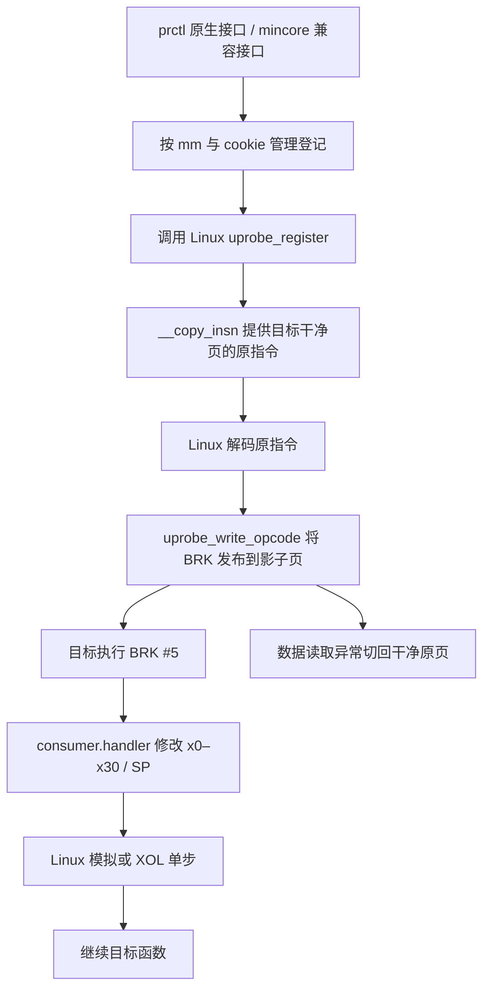

# Kernel-Trace 与 wxshadow 的结合：wxuprobe

2026-10-19 更新：新增 BTF 自动结构布局、GUP API 和 LTO 入口适配，已用 5.10 基准对象在 Pixel 6 / Android 16 / Linux 6.1.134 上通过完整设备脚本，包括 2000 个活动入口、全部寄存器、生命周期、tracefs 日志和完整卸载。当前要求及验证范围见[跨内核兼容说明](kernel-compatibility.md)；下文 5.10 记录属于原版实现。

模块用法、编译和 ABI 见 [wxuprobe README](../kpms/wxuprobe/README.md)。本页记录现有实现的梳理、集成位置和实际验证范围。

## 1. 当前项目的逻辑

根 README 描述的是按页分离读取和执行：保存干净原页，另建写入 hook 指令的影子页。修改页表权限后，数据读取和取指分别触发权限异常，由内核切换到对应物理页。这样用户态直接读取代码时仍得到原始字节。

`kpms/wxshadow` 还包含直接断点和普通 patch 接口。现有 Dobby 后端在影子页发布一条 B 指令，Dobby 自己负责 original/relay 和指令重定位。其 VM 适配层已经处理 mmap/PTL 锁、MMU notifier、页引用、TLB/cache 维护及 QUIESCE 清理。

这套页面机制可以承载其他 hook 指令，但不能解决同页自读：若执行页中的一条指令同时读取该页，数据与取指所需的页权限互相冲突。

## 2. Kernel-Trace 的实现

阅读的源码：[kernel_trace.c](../Kernel-Trace/kernel_trace.c)、[uprobe_trace.h](../Kernel-Trace/uprobe_trace.h)、[用户头](../Kernel-Trace/user/uprobe_trace_user.h)。该目录保持原样，没有改动。

| 部分 | 原项目做法 |
|---|---|
| 控制接口 | 拦截 mincore，用 511/512/513 表示初始化、添加、清除 |
| 配置 | 全局 UID、模块基址、目标文件 inode 和替代文件 |
| 注册 | `uprobe_register(inode, file_offset, &trace_uc)`，最多 2000 个偏移 |
| 命中 | Linux 分发到 consumer.handler，按 UID 和 `pc - module_base` 查红黑树并 trace_printk |
| 原指令执行 | Linux 处理 `BRK #5`，模拟特定指令，或在 XOL 页执行后单步返回 |
| 运行时解密 | hook `do_read_cache_page`，用替代文件的页覆盖 uprobe 读取原指令的数据来源 |
| XOL 映射 | 修改创建地址和映射名称 |

uprobe 的索引是 inode 与**文件偏移**，不是运行时虚拟地址或 ELF load bias。正确关系是：

```text
file_offset = function_address - mapping_start + mapping_file_offset
```

原项目的问题来自其额外的适配和生命周期处理：

- 替代文件路径返回 `vmalloc_to_page()` 后立即 `vfree()`，内核得到的 page 已失去有效存储；另有分配/错误路径泄漏。
- 使用全局配置和同一个 consumer，未提供本项目需要的每 mm、每地址寄存器配置与可靠并发控制。
- 直接调用 `__arch_copy_from_user`，既绕过原生 uaccess 包装，又按负数判断其返回值；该原语返回的是未复制字节数。
- exit 中主动调用一次没有本模块对应加锁的 `rcu_read_unlock()`，随后执行可能休眠的注销。正确办法是将清理移到普通系统调用上下文。
- 没有本项目需要的完整映射失效、进程退出、注册失败回滚和安全卸载协议。

## 3. 集成方式

新模块为独立的 `wxuprobe.kpm`。它沿用 Linux uprobe 的执行机制，将 wxshadow 的页发布与退役逻辑接到 uprobe 的**原指令读取和断点写入**两个位置。



### 原指令与 BRK 的归属

注册前从目标映射 pin 住的干净页读取原指令。`__copy_insn` 的拦截仅在本模块当前注册操作、同一 task、正确 inode mapping 和文件偏移匹配时提供这 4 字节。

Linux 随后仍执行原生的指令验证、解码和 XOL 准备。`uprobe_write_opcode` 的拦截确认 arch_uprobe、目标 mm、地址和安装状态后，重建整页影子：复制干净页，叠加该页所有活动 hook 的 `BRK #5`，维护 cache，再通过 PTL 发布执行页 PTE。

这一过程没有给磁盘文件或原页写入 BRK。运行时解密后的私有页可以直接提供真实原指令，无需原 Kernel-Trace 的全局页缓存替换和替代 so 文件。

同一 inode/offset 的既有 uprobe 可能缓存了不同的原指令。为避免共用 arch_uprobe 改变其他消费者语义，本模块要求本次确实发生新的 `__copy_insn`，拒绝复用已有探针，也拒绝其他消费者写入本模块的活动影子页。相关登记退役后仍需 REMOVE/CLEAR 才释放 uprobe 所有权。

### 寄存器修改

每个入口保存独立的 `reg_mask` 和 32 个值。handler 在 `current->mm`、入口 PC、ACTIVE 状态均匹配后，先写 `pt_regs.regs[0..30]` 和可选的 SP，再交还 Linux。原指令的输入因此已经改变。

PC/PSTATE 继续由 Linux 的模拟、XOL 和单步控制；没有引入第二套 BRK/单步处理器。普通 add 等指令实际通过 XOL，B/ADR 等由内核模拟，均已在设备验证。

### 页面与生命周期

- 权限异常只接管用户态、对应页的读/执行权限故障；写故障退役该页并交回正常 VM 路径。
- notifier 在 mprotect/unmap/mm_release 时恢复映射、记录 RETIRED。非阻塞 invalidation 返回 EAGAIN，让内核在可阻塞上下文重试。
- `follow_page_pte` 在 GUP 读取影子之前恢复原映射，因此 `/proc/self/mem` 得到原指令，并使该页 hook 退役。
- `dup_mmap` 前恢复父映射，并把 control_lock 持有到原函数返回，关闭恢复与复制之间的再次安装窗口。即使尚无 context，也必须持锁以排除第一次注册的竞态。
- 删除某个入口时重建影子，保留同页其余 BRK；最后一个入口删除时恢复原始 PTE。
- 原页、历史影子页、cookie 墓碑和 context 保留到管理员 QUIESCE，避免已提交操作的恢复查询或并发执行引用失效对象。

### 锁和卸载

总体锁序：control → 内核 uprobe 锁 → mmap_lock → state → PTL。不能持 mmap/state 锁调用 uprobe_register/unregister。fork 前后回调跨越实际 dup_mmap 持有 control，notifier 只进入 state/PTL 路径。初始化在全部必需 hook 安装完成后才原子开放 API，失败回滚期间不能创建 consumer/context。

请求输入在这些锁之前复制，输出在锁释放之后复制。复制调用内核 `access_process_vm`，不使用 FOLL_FORCE；正常处理缺页、COW 和读写权限。先按 ARM64 `untagged_addr` 处理 Android 堆指针的顶字节标签。

QUIESCE 在普通 prctl 上下文注销全部 consumer/notifier，等待同步并释放引用，然后将实例置为停止状态。KernelPatch 的 ctl0/exit 位于装载器的 RCU 临界区，无法执行这段可能休眠的清理；装载器还会忽略 exit 错误，故只能通过明确的客户端 QUIESCE 流程完成卸载。模块用 `hook_unwrap` 删除自己的回调，保留其他 hook 链成员。

## 4. 源码位置

| 文件 | 责任 |
|---|---|
| [wxuprobe.c](../kpms/wxuprobe/wxuprobe.c) | KPM 生命周期、vmlinux 精确符号查找、syscall/VM/uprobe hook 桥接及回滚 |
| [wxuprobe_linux.c](../kpms/wxuprobe/linux/wxuprobe_linux.c) | 目标内核真实类型、consumer、页面发布/退役、寄存器更新、协议和清理 |
| [wxuprobe_uapi.h](../shared/wxuprobe_uapi.h) | 固定宽度 440 字节原生 ABI |
| [wxuprobe_client.h](../shared/wxuprobe_client.h) | 应用内 prctl 包装 |
| [wxuprobe_kernel_trace.h](../shared/wxuprobe_kernel_trace.h) | 原 ARM64 mincore ABI 与寄存器更新/单独删除扩展 |
| [wxuprobe_client.c](../kpms/wxuprobe/wxuprobe_client.c) | 命令行管理客户端 |
| [device_tests.c](../tests/wxuprobe/device_tests.c)、[capture.S](../tests/wxuprobe/capture.S) | 自有文件映射、寄存器捕获和设备断言 |
| [run-device-tests.ps1](../tests/wxuprobe/run-device-tests.ps1) | 部署、权限测试、tracefs 验证、日志和有序卸载 |

新 VM 实现基于现有 wxshadow 的页表/cache/TLB/notifier 设计，包含来源说明；现有 Dobby/wxshadow 实现、Kernel-Trace 源码以及 `.kp` 框架均未修改。

## 5. 实机验证

日期：2026-10-18。设备为 Redmi 22041211AC / rubens，Android 12、ARM64、4KB 页。

| 项目 | 实际值 |
|---|---|
| 内核 | `5.10.66-android12-9-00001-gd262b276948e-ab8291727` |
| 源码 | Android common `d262b276948e382dbaa38474845bac692bae4236`，使用设备完整配置 |
| Native 对象编译 | WSL Ubuntu 24.04，Android Clang r498229b，Kbuild |
| KPM 桥接编译 | aarch64-none-elf-gcc 14.2，保留 x18、禁用 SIMD |
| Android 测试/CLI | NDK 25.1.8937393，arm64-v8a，android-24，Release |
| 模块 | wxuprobe 1.0.0，235192 字节 |
| 模块 SHA256 | `8FADF817CC0C495F993991B0E418BCA83E05587F1428D5E09FF399EC2DC9C834` |
| QUERY | ABI=1，size=440，page=4096，capabilities=0x3f |

已通过的真实设备断言：

| 场景 | 结果 |
|---|---|
| 模块加载前/卸载后 | API 返回 EINVAL，严格不可用 |
| 普通首条 ADD 的 XOL | 基线 `(3+4)+1=8`；入口改 x0=10/x1=20 后返回 31 |
| 原页可见性 | hooked 页逐字节读取计算的整页 hash 与安装前相同，入口读取仍为原指令 |
| 同页多入口 | 删除一个后其他入口继续生效；最后恢复全部原行为 |
| x0–x30 与 SP | 目标从首条指令开始捕获全部值，32 项逐一核对通过 |
| 模拟指令 | B 和 ADR 行为正确 |
| 运行时解密 | 磁盘首条 ADD、内存首条 SUB，hook 执行 SUB，读取 hash 不变 |
| 控制与重试 | UPDATE/清除寄存器 mask、cookie 幂等、重复删除、状态/命中计数 |
| 异常请求 | 坏指针、size、instance、地址对齐、文件偏移、mask、SP、reserved 均拒绝 |
| 输出写回失败 | 只读请求使 INSTALL 返回 EFAULT；STATUS 找到已提交的 ACTIVE，命中并可撤销 |
| 并发 | 两个执行线程共 800 次命中；另一线程完成 200 次整页 hash 校验，命中数精确为 800 |
| 原 Kernel-Trace ABI | 初始化/添加/清除通过，新增寄存器更新/单独删除通过，149 字节名称及清除后重装通过 |
| 生命周期 | mprotect、fork、GUP 读取、unmap 均退役并恢复原映射；fork 后的 COW 请求写回通过 |
| 跨进程 | root 修改子进程入口，父 mm 不变；普通 shell 跨进程返回 EPERM |
| 批量 | 2000 个同时活动入口分布于 16 页；整页 hash 不变；第 129 个同页 hook 返回 ENOSPC；交错删除后剩余入口正常 |
| 退出和卸载 | 故意带活动 consumer 退出后，root QUIESCE 和 kpm unload 成功，模块列表恢复无 wxuprobe |
| tracefs | shell/root 两次测试的独立函数名均找到 `+Test-Log+ wxuprobe` 记录，tracing_on 恢复原值 |
| 内核日志 | 本次 load 到 unload 区间未出现 BUG/WARNING/Call trace/Internal error/UNSAFE UNLOAD |

设备脚本输出以 `ALL WXUPROBE DEVICE CHECKS PASSED` 结束。可复现日志位于忽略的 `build/wxuprobe-device/logs/`。脚本使用实际 dmesg 时间戳划定本次日志边界，避免设备休眠使 printk 时钟和 `/proc/uptime` 不一致而漏检。

### 实机发现并修复

1. nofault 输出无法写回 fork 后的 COW 栈页。改用可缺页的原生复制路径，并将用户内存访问放到管理锁外。
2. Android `calloc` 返回带 `0xb4` 等顶字节标签的堆指针，直接比较 task_size 会误报 EFAULT。请求复制先清除地址标签，2000 个堆上请求已通过。
3. 增加“安装已提交但输出失败”的设备断言，验证 cookie 可恢复，而非把 EFAULT 视为未安装。
4. fork 在零 context 时也不能跳过 control_lock，否则第一次注册可能落入页表复制窗口。

验证来自一台设备及自有测试代码页。没有验证其他内核、厂商配置、页大小、BTI/PAC、任意应用的整页行为，或执行线程不停机时安装/撤销。上述不在本次支持范围。
